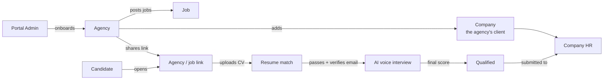
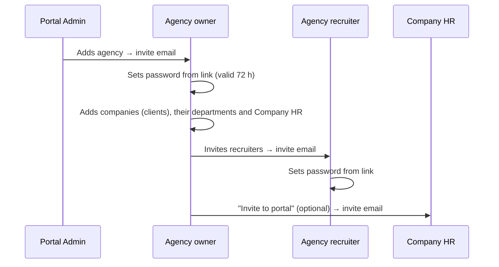
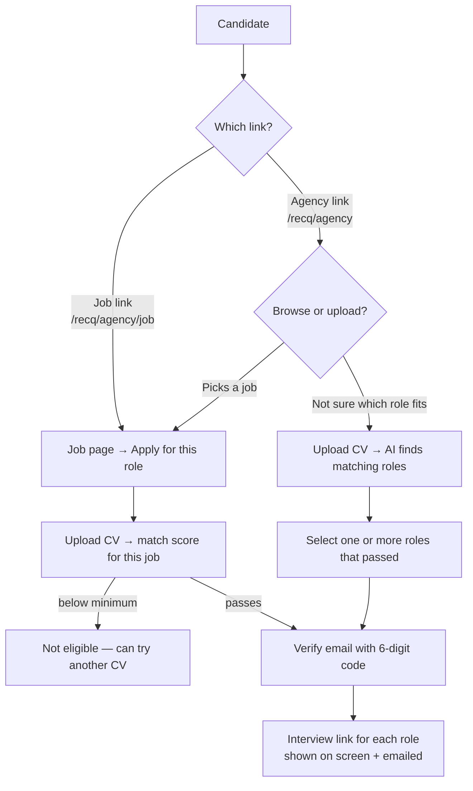
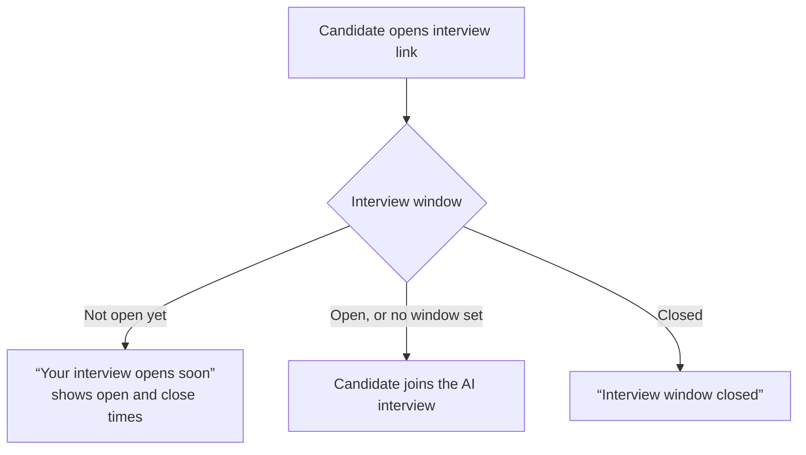
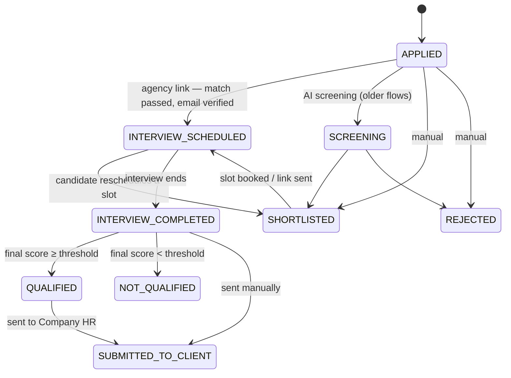

# RecruitIQ — System Flow

How RecruitIQ works from start to finish: who uses it, what each person does, and what the system does
automatically at each step. For setup, code structure and API details, see [README.md](README.md).

---

## 1. The big picture

RecruitIQ is used by **recruitment agencies**. An agency hires on behalf of its **client companies**.

In one sentence: **an agency posts a job and shares its link → candidates upload a CV and see their match
score → those who pass verify their email and get an AI voice interview → the best are submitted to the
client company's HR.**

---

## 2. Who uses the system

| Person | Shown in the app as | Signs in at | What they do |
| --- | --- | --- | --- |
| Platform owner | **Portal Admin** | `/admin` | Adds agencies, suspends or reactivates them, manages all users |
| Agency owner | **Agency** | `/company` | Everything inside their agency: jobs, candidates, interviews, companies, recruiters |
| Agency staff | **Agency recruiter** | `/company` | Only the jobs/companies assigned to them, with only the permissions the owner gave |
| Agency's client | **Company** | — (no login) | A record the agency keeps: name, contacts, departments |
| Client's hiring contact | **Company HR** | `/client` | Sees the candidates the agency sent them (view only), can ask for a second interview |
| Job seeker | **Candidate** | — (no login) — the agency's link (`/recq/…`) and the links in their emails | Uploads a CV, verifies their email, takes the interview, gets every update by email |

There is **no sign-up page**: agencies are added by the Portal Admin, and candidates come in through an
agency's link. `/auth/register` redirects to the login page.

### Recruiter permissions

The agency owner ticks what each recruiter may do:

| Permission | Allows |
| --- | --- |
| View candidates *(default for new recruiters)* | See applicants, scores, interview results and CVs — no actions |
| Review candidates | Run screening, reject (or shortlist older applications), second interviews, screening settings |
| Manage jobs | Create, edit and close jobs |
| Configure interviews | AI interviewer settings, interview window (together with *Manage jobs*), interview links |
| Manage recruiters | Invite recruiters, set their permissions and job assignments |
| Manage clients | Companies, departments and Company HR |
| Submit candidates | Send qualified candidates to Company HR |

A recruiter only ever sees jobs assigned to them, jobs they created, and jobs of companies assigned to
them. They can't change their own access or assignments.

---

## 3. Getting set up

1. **Portal Admin adds an agency** (`/admin/companies/new`). The owner gets an email with a one-time
   link to set their password. This is the only way an agency is created. (The very first Portal Admin is
   created with `scripts/create-admin.mjs`.)
2. **The agency adds its client companies** (Companies → Add company): name, industry, website, contact
   person, email, phone, address.
3. For each company, the agency adds **Company HR** (name, email, phone, designation) and, optionally,
   **departments** as labels (IT, Finance…).
4. **The agency invites recruiters** (Agency recruiters → Invite), picks their permissions and jobs.
5. **Company HR can be invited to the portal**, or are invited automatically the first time a candidate
   is submitted to them.
6. **The candidate link**: every agency gets a public page at `/recq/<agency-name>` that lists its open
   jobs. It is shown as **Your candidate link** on the Jobs page, where it can be copied or renamed
   (renaming breaks the old link). Old `/careers/<agency-name>` links redirect to it.

Forgot your password? `/auth/forgot-password` emails a reset link valid for 1 hour.

---

## 4. The hiring journey

### Step 1 — Create a job

**Who:** Agency owner or a recruiter with *Manage jobs*. **Where:** Jobs → Create a job.

1. Enter a **title** and a **description**. Write everything you know in the description — skills,
   experience, education, location, work mode, salary, notice period, languages, certifications.
2. Optionally link the job to a **company** and its **Company HR** (who will receive candidates).
3. Click **Auto-fill details from description**: the AI reads the description and fills the "More
   details" fields. Anything you already set yourself is kept. Check the filled fields
   (marked *Filled from the description*) and change anything that's wrong.
4. Click **Publish job**. Any detail you never touched is still filled from the description on save, and
   the AI adds the required / preferred skills it finds. The job gets its own link,
   `/recq/<agency>/<job-title>`.

After publishing, the job's pages let you set:

| Setting | Where | What it does |
| --- | --- | --- |
| Candidate links | Interviews & setup → share card | Copy the link for **this job** or for **all your open roles** |
| Interview window | Interviews & setup → share card | When candidates may take the interview (**Opens** / **Closes**) |
| AI interviewer | Interviews & setup → AI Interviewer Configuration | Name, title, voice, number of questions, answer time, custom questions, instructions, evaluation criteria |
| Minimum score | Applications → Job settings → Screening settings | The resume match a candidate needs to get an interview (default 75) |
| Auto-reject / auto-advance | Applications → Job settings → Screening settings | Only for applications from the older flows (see Step 2) |
| Final score | Applications → Job settings → Final score settings | CV vs interview weight, pass threshold, auto-submit to Company HR |
| Assigned recruiters | Job page | Which recruiters work on this job |

### Step 2 — Candidates apply through the agency's link

The agency shares one of two links (by email, WhatsApp, job boards…). Neither needs a login.

**Job link** — `/recq/<agency>/<job>`: *Resume → Match → Verify → Interview*.
1. The candidate reads the job and clicks **Apply for this role**.
2. They upload a CV (PDF or DOCX). The AI reads it and scores it against the job straight away.
3. They see a **Resume Match** score out of 100 with a skills / experience / education breakdown and the
   skills that matched. A score at or above the job's minimum means **eligible**; below it, they also see
   the missing skills and can try another CV.

**Agency link** — `/recq/<agency>`: *Resume → Matches → Verify → Interview*.
- The candidate can browse the agency's open jobs (search by title, skill or location) and open one —
  that continues as the job link above.
- Or, **Not sure which role fits?**: they upload a CV once and the system scores it against the
  agency's best-fitting open jobs (a quick keyword pre-rank, then a full AI match on the top 6). They see
  each role's score and pick the eligible ones to apply to.

**Verify email**
- The 6-digit code is sent **only to the email address written on the CV** — the candidate never types an
  email. The screen shows it masked (`j•••@gmail.com`).
- The code is valid 5 minutes, allows 5 tries, and can be re-sent after 30 seconds (at most 3 codes per
  email per 15 minutes).
- The uploaded CV is kept for 24 hours; after that the candidate has to upload it again.

**What happens on apply** (for each selected role):
- **Eligible** → an application is created with the CV match already saved as its screening result, the
  status jumps to **Interview scheduled**, and the candidate gets their personal interview link on screen
  and by email.
- **Not eligible** → no application is created.
- **Already applied** to that job → no duplicate; the candidate is shown their existing interview link.
- The candidate's account is created from the CV (name and email) the first time, or reused if one
  already exists for that email. An email that belongs to an agency, HR or admin account is refused.
- The score saved is exactly the one the candidate saw. It is only recalculated if the job was edited in
  between.

**Older ways in** — still supported for existing data, but switched off or hidden by default:
- **Candidate job board** (logged-in candidates browsing every agency's jobs): retired — candidates no longer
  have a login, so `FEATURE_CANDIDATE_JOB_BOARD` has no effect.
- **Careers page with phone verification and CV-only submission**: the public `/careers/<agency>` entry
  pages now redirect to `/recq/<agency>`. Applications made that way earlier, and the **CV pool**
  (`/company/cv-pool`), still work.

### Step 3 — Review applications

**Who:** Agency or any recruiter on the job (actions need *Review candidates*). **Where:** Job →
Applications.

1. Summary tiles at the top: **Total applied**, **Interview completed**, **Interview pending**, **Not
   eligible / rejected**.
2. The list shows each candidate's **resume match**, **interview** status and AI score, experience and
   status. Filter and sort by score, experience, skills, education and status. On phones the list becomes
   cards.
3. Per candidate: view, download the CV, or **Reject**. Bulk reject works on selected rows.
4. **AI screening** is optional — candidates from the agency link are already scored when they apply:
   - **Run AI Screening · Applicants** scores any CV not scored yet (**Re-run** scores them again).
   - **Run AI Screening · Interviewed** recalculates the final score of everyone who finished an
     interview.
5. Each CV score is built from fixed checks (skill overlap, years of experience, education match) plus
   the AI's reading of the CV against the job. The AI never sees the candidate's **name, gender or other
   personal details**.
6. **Shortlist All Screened** only appears while applications from the older flows are waiting for a
   shortlist decision. Shortlisting or rejecting such an application emails the candidate, and bulk
   actions skip anyone who already has an interview or later status.

### Step 4 — Interview access

**Agency-link candidates** get their interview link the moment they verify their email — no
shortlisting and no booking. When they can use it depends on the job's **interview window**:

- The window is set per job on **Interviews & setup** (needs *Manage jobs* and *Configure interviews*).
  Without a window, the link is valid for 7 days from when it was issued.
- Changing the window moves the expiry of every link already sent for that job.
- A candidate who started the interview and lost their connection can always rejoin with the same link.
- If the agency is suspended, interviews that haven't started can't begin.
- These rules are checked by the server too, so nobody can get around them by calling the API directly.

**Older-flow candidates** (shortlisted from the careers page or the job board) keep the rules they had:
- **Time slots** — the candidate books one of the agency's slots from their application page or status
  link; a slot can only be booked once, and the candidate can reschedule until the interview starts.
- **Instant link** — a personal link valid until it expires (default 7 days), sent when shortlisted.
- The agency can re-send a link (email or SMS) from the candidate's page. Creating new slots and switching
  a job's interview flow are no longer on the Interviews page.

### Step 5 — The AI voice interview

**Who:** Candidate. **Where:** the interview room (from their interview link or application page).

1. The candidate turns on camera and microphone. The camera is for presence only — **nothing is
   recorded**; only the transcript and events (camera off, tab switch, connection lost…) are kept.
2. The AI interviewer (e.g. "Priya – Virtual HR") speaks each question. The candidate answers out loud
   and presses Send. Each answer has a time limit.
3. The interview follows a **fixed order**: introduction → resume questions → basic technical →
   job-specific → scenario → behavioural → candidate's questions → end.
4. The AI only chooses the wording of questions (from the job, the CV and earlier answers) and whether
   one follow-up is needed. The order, number of questions and the end are fixed by the system.
5. **Difficulty adapts**: strong answers make the next question harder, weak ones easier, within the
   job's seniority level.
6. The agency's **custom questions** are always asked, and its **interview instructions** and
   **must-cover skills** steer the questions.
7. At the end the candidate can ask questions; the AI answers from the job description and company info
   only (never promises a result or salary), then closes the interview.

Voice runs through a separate worker service (`livekit-worker/`) using LiveKit and Deepgram.

### Step 6 — Interview report and final score

As soon as the interview ends, the system:

1. Writes the **interview report**: overall, technical and communication scores, strengths, concerns
   and a summary. If the agency set **evaluation criteria**, each one gets *Met / Partly met / Not met*
   with evidence. The full transcript is kept (raw and cleaned).
2. Calculates the **final score**: `CV score × CV weight + interview score × interview weight`
   (default 30% / 70%).
3. If the job has a **pass threshold**, the candidate becomes **Qualified** or **Not qualified**.
4. With *auto-submit* on, qualified candidates are sent to the job's Company HR automatically.

The agency reads everything on Job → Interviews & setup → interview. Candidates see their resume match
score when they apply, but never their interview or final scores — only that the interview is complete.

### Step 7 — Submit to the company

**Who:** Agency or a recruiter with *Submit candidates*. **Where:** the candidate's page → Submit to
company.

Only candidates who finished the interview (*Interview completed* or *Qualified*) can be submitted;
*Not qualified* candidates can't.

1. Preview the candidate package: contact details, CV match, interview summary and scores.
2. Send it to a Company HR (or any email) with an optional note.
3. The HR person gets an email with a **private link** to a read-only package (`/submission/<token>`)
   and the CV. Opening it marks the submission *Viewed*.
4. The candidate's status becomes **Submitted to client**. The submission history shows who sent what,
   when, and whether it was viewed.

### Step 8 — Company HR reviews

**Who:** Company HR. **Where:** `/client/candidates` (after accepting the portal invite).

1. They see **only** the candidates submitted to them — never other departments' or companies'.
2. Each candidate shows scores, the interview summary and the CV (view or download).
3. If they need more, they click **Request second round**.

### Step 9 — Second-round interview (optional)

1. Company HR (**Request second round**) or the agency (**Give second interview**) picks a reason
   (technical issue, not ready, need more detail, other) and adds notes.
2. The candidate gets a new instant interview link straight away; the agency is emailed when HR asks.
3. The notes steer the second interview's questions. Round 1 is kept.
4. The final score uses the latest round. At most 2 rounds per application.

---

## 5. Application statuses

Agency-link candidates go straight from *Applied* to *Interview scheduled* in the same step. A candidate
whose match is below the minimum never gets an application, so there is nothing to reject.

| Status | Meaning | Candidate sees |
| --- | --- | --- |
| Applied | Application received | Applied |
| Screening | CV screened, waiting for a decision (older flows) | Screening |
| Shortlisted | Passed — next is the interview (older flows) | Shortlisted |
| Rejected | Not moving forward | Rejected |
| Interview scheduled | Interview link issued (or slot booked) | Interview scheduled |
| Interview completed | Interview done, report written | Interview completed |
| Qualified / Not qualified | Final score vs the job's threshold | Interview completed |
| Submitted to client | Sent to Company HR | Interview completed |

Interview statuses: **Scheduled → In progress → Completed** (or **Cancelled**).

---

## 6. Emails and messages

| When | Who gets it |
| --- | --- |
| Agency added / recruiter invited / Company HR invited | The new user — link to set a password (72 h) |
| Forgot password | The user — reset link (1 h) |
| Candidate verifies on an agency link | Candidate — 6-digit code, sent to the email on their CV |
| Candidate passes and is verified | Candidate — interview link, with the interview window if one is set |
| Shortlisted or rejected (older flows) | Candidate |
| Shortlisted on an instant-link job (older flows) | Candidate — interview link |
| Slot booked (older flows) | Candidate — confirmation with date and time |
| Guest applies on the careers page (older flow) | Candidate — confirmation and status link |
| Interview completed (AI interview ends, or the agency marks it done) | Candidate — confirmation, no scores |
| Booked slot cancelled by the agency (older flows) | Candidate — link to pick a new time |
| Candidate submitted | Company HR — private link to the candidate package |
| Second round requested by Company HR | Agency |
| Second round created | Candidate — new interview link |
| Phone verification (older careers flow) | Candidate — 6-digit code by SMS |

Emails go through SMTP (`EMAIL_SMTP_*`, or Brevo with `EMAIL_PROVIDER=brevo`); without either configured they are printed in the server log instead (and, outside
production, the email code is also shown on the page). SMS codes go through Twilio, or are printed in the
server log by default. Every link in an email — and the agency/job links recruiters copy — uses the
address in `PUBLIC_APP_URL`.

---

## 7. Without logging in

Candidates have **no login, password or dashboard** — signing in with a candidate email is refused, and old
`/candidate` links go to the home page. Every candidate email carries their personal status link, and every
status change they need to know about is emailed:

- **Agency link** `/recq/<agency>` — browse the agency's open jobs, or upload a CV to find matching roles.
- **Job link** `/recq/<agency>/<job>` — one job: upload CV, see the match, verify, get the interview.
- **Interview link** `/interview/<token>` — start or resume the AI interview inside its window.
- **Status link** `/careers/track?token=…` — in every candidate email: progress timeline, the interview link,
  and (older slot flows) book / change / join a slot interview. Always on, whatever the feature switches.

Old `/careers/<agency>` links redirect to the agency link. Company HR can likewise open submitted
candidates from the emailed link without a portal account.

---

## 8. Safeguards built into the flow

- **Fair screening**: the AI never receives name, gender or other personal details; recruiter
  instructions that mention protected characteristics are removed before they reach the AI.
- **AI is never the only judge**: screening blends fixed checks with the AI; the interview order and
  length are fixed by the system.
- **The server decides eligibility**: the match score is computed and stored on the server; the page
  never sends a score. Candidates see only their score and skill lists, never the AI's reasoning.
- **Only the CV's owner can apply**: the email code goes only to the address on the CV, and the
  verification is tied to that one CV and that one agency.
- **Public pages show only public data**: agency and job links list only that agency's *open* jobs, and
  never client names, Company HR, thresholds or internal settings.
- **No duplicates**: one application per candidate per job; applying again shows the existing interview.
- **No recordings**: camera and microphone are live only; no audio or video is stored.
- **Validated input everywhere**: every form checks its fields (names, emails, phone numbers with one
  leading `+`, websites must be `http(s)`, length limits, dates not in the past, interview window must end
  after it starts) in the browser and again on the server.
- **Private links**: invite, reset, interview and submission links are single-use or revocable; only
  their hashes are stored. Interview links only open that one interview.
- **Access control**: recruiters see only their assigned work; Company HR see only what was sent to
  them; suspended agencies and deactivated users can't sign in, and a suspended agency's interviews
  can't start.
- **Race-safe booking**: a slot can only be booked once, and a candidate can't book two interviews.

---

## 9. Feature switches

Some parts of the flow are turned on per deployment in `.env`:

| Switch | Default | Turns on |
| --- | --- | --- |
| `FEATURE_RECQ` | on | Agency and job links (`/recq/…`) — the main candidate flow |
| `ALLOW_COMPANY_SELF_REGISTER` | off | Agencies can sign up themselves (API only — there is no sign-up page) |
| `FEATURE_CANDIDATE_JOB_BOARD` | off | Retired — candidates have no login, so this no longer does anything |
| `FEATURE_GUEST_APPLY` | off | Older flow: careers-page guest apply with phone code, CV-only submission |
| `FEATURE_INSTANT_INTERVIEW` | off | Instant interview links for older-flow and second-round interviews |
| `FEATURE_CLIENT_PORTAL` | off | Company HR portal logins |
| `DEMO_PAGE` | off | Shows the demo accounts' password on the `/live-demo` page |

`PUBLIC_APP_URL` isn't a switch but matters to the flow: it is the address used in every emailed link and
in the agency/job links recruiters share (defaults to `CLIENT_URL`).

Everything else in this document is always on.
